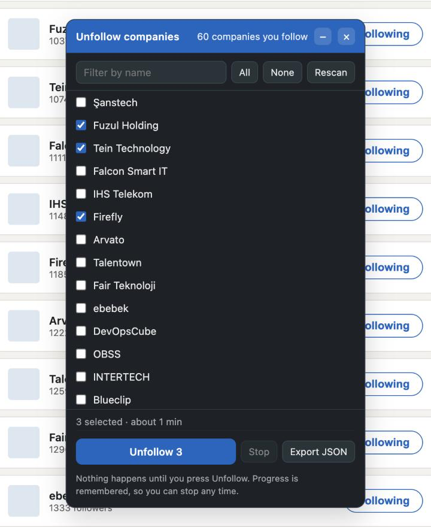

<div align="center">

# linkedin-unfollower

**Unfollow 300 LinkedIn companies without clicking 300 times.**

Paste one file into your browser console. A panel opens, lists every company
you follow, and unfollows the ones you tick — slowly enough that LinkedIn
never notices, and resumably enough that you can close the tab whenever.

[](LICENSE)
[](#install)
[](#the-rust-cli)
[](https://github.com/enesyaks/linkedin-unfollower/stargazers)



</div>

---

## Why

LinkedIn gives you no way to bulk-unfollow. The companies page shows 20 at a
time behind a *Show more* button, and every unfollow is a separate click. If
you follow a few hundred — and after a job hunt, you do — that is an afternoon.

Most tools that solve this hardcode LinkedIn's internal API endpoints, so they
break within months. This one hardcodes nothing. It finds buttons by their
**accessible label**, which LinkedIn cannot obfuscate without breaking screen
readers.

## Install

Three ways, best first. There is no build step and no npm install.

### 1. Userscript — install once, always there

Install [Tampermonkey](https://www.tampermonkey.net/) or
[Violentmonkey](https://violentmonkey.github.io/), then open
[`web/unfollow.js`](web/unfollow.js) raw and click install. The panel then
opens by itself whenever you visit your companies page.

### 2. DevTools Snippet — paste once, run forever

In Chrome: DevTools → **Sources** → **Snippets** → New snippet → paste
[`web/unfollow.js`](web/unfollow.js) → save. Run it any time with `⌘⏎` / `Ctrl+Enter`.

### 3. Console paste — zero setup

```bash
curl -s https://raw.githubusercontent.com/enesyaks/linkedin-unfollower/main/web/unfollow.js | pbcopy
```

Open [your companies page](https://www.linkedin.com/mynetwork/network-manager/company/),
press `⌘⌥J` / `F12`, type `allow pasting` if Chrome asks, paste, Enter.

> **Why there is no one-line bookmarklet.** LinkedIn serves
> `script-src 'strict-dynamic' 'nonce-…'`, so a snippet that fetches this file
> from GitHub is blocked by the page's CSP — verified, not assumed. The whole
> file has to arrive in the console, or through a userscript manager that
> bypasses page CSP. The upside: you can read every line before you run it.

## Use it

The panel opens on load and scans your full list (about 20 seconds for 135
companies). Then: filter, tick, press **Unfollow**, press again to confirm.

Nothing is clicked until you confirm. Progress is saved after every company,
so you can stop any time and pick up later — even days later.

<details>
<summary><b>Console API</b> — everything the panel does, scriptable</summary>

```js
await LIU.scan()                        // load the full list
LIU.list()                              // print it as a table
LIU.download()                          // save companies.json
await LIU.unfollow()                    // DRY RUN — clicks nothing
await LIU.unfollow({ confirm: true })   // for real, max 50 per run
LIU.open()                              // re-open the panel
LIU.stop()                              // abort after the current step
LIU.config({ minDelay: 4000 })          // go slower
LIU.resetState()                        // forget what has been done
```

| Call | What it does |
|---|---|
| `LIU.unfollow({ confirm: true, limit: 10 })` | only the first 10 |
| `LIU.unfollow({ only: /recruit/i, confirm: true })` | name/slug matching a regex |
| `LIU.unfollow({ except: ['Acme Corp'], confirm: true })` | keep these |

</details>

## How it stays under the radar

| | |
|---|---|
| Gap between clicks | 1.8–4.2 s, randomised |
| Long pause | 20–40 s after every 15 |
| Hard cap | 50 per run |
| Stops on | HTTP 429 / 999 / 403, or 3 failures in a row |
| Remembers | every finished company, in `localStorage` |

About 50 companies per 5-minute run. Doing 400 in one sitting is how you end
up looking at a rate-limit page, so run it a few times instead.

## The Rust CLI

For a few hundred companies, unattended, with your browser free. It ships with
**no** knowledge of LinkedIn's API: you capture one real unfollow request from
your own Network tab, mark the company id with `{urn}`, and the CLI replays it
with a token bucket, exponential backoff and a resumable checkpoint.

```bash
cd cli && cargo build --release
```

```bash
liunfollow run --list companies.json --request unfollow.curl --max 25 --yes
```

Every run is a dry run unless you pass `--yes`. Full walkthrough:
[docs/capture.md](docs/capture.md).

<details>
<summary><b>Options</b></summary>

```
--only <REGEX>        only companies whose name/slug/urn matches
--except <REGEX>      skip companies whose name/slug/urn matches
--max <N>             stop after N companies in one run        [50]
--interval <SECONDS>  base gap between requests                [4.0]  (min 0.5)
--jitter <0..1>       randomise each gap by this fraction      [0.4]
--batch-size <N>      long pause every N requests, 0 = off     [15]
--batch-pause <SECS>  length of that pause                     [30]
--retries <N>         retries per company when rate limited    [3]
--abort-after <N>     give up after N back-to-back failures    [3]
--backoff <SECONDS>   first backoff wait, doubles each retry   [60]   (min 1)
--backoff-max <SECS>  ceiling for that doubling                [900]
--retry-failed        re-attempt companies that failed before
--state <FILE>        checkpoint path        [liunfollow-state.json]
--yes                 actually send the requests
```

</details>

## Good to know

- LinkedIn's User Agreement restricts automated access. The panel clicks the
  same buttons you would, slower than you could be bothered to; the CLI
  replays a request you made yourself. It is still automation, and the risk is
  yours.
- Your captured cURL file holds your session cookie. `chmod 600` it. The CLI
  redacts it from every line it prints, and `.gitignore` blocks `*.curl`.
- This repository ships no working LinkedIn endpoint, query id or token.
- Works in LinkedIn's English and Turkish interfaces.

## Development

```bash
make test
```

61 tests, no network needed: the Rust side puts HTTP and the clock behind
traits; the JavaScript side runs against a hand-rolled fake DOM carrying
LinkedIn's real label shapes. `web/test/fixture.html` is a local stand-in for
the companies page, so you can click through a whole run without an account —
see [CONTRIBUTING.md](CONTRIBUTING.md).

## License

MIT © Enes — see [LICENSE](LICENSE).

Türkçe: **[README.tr.md](README.tr.md)**
