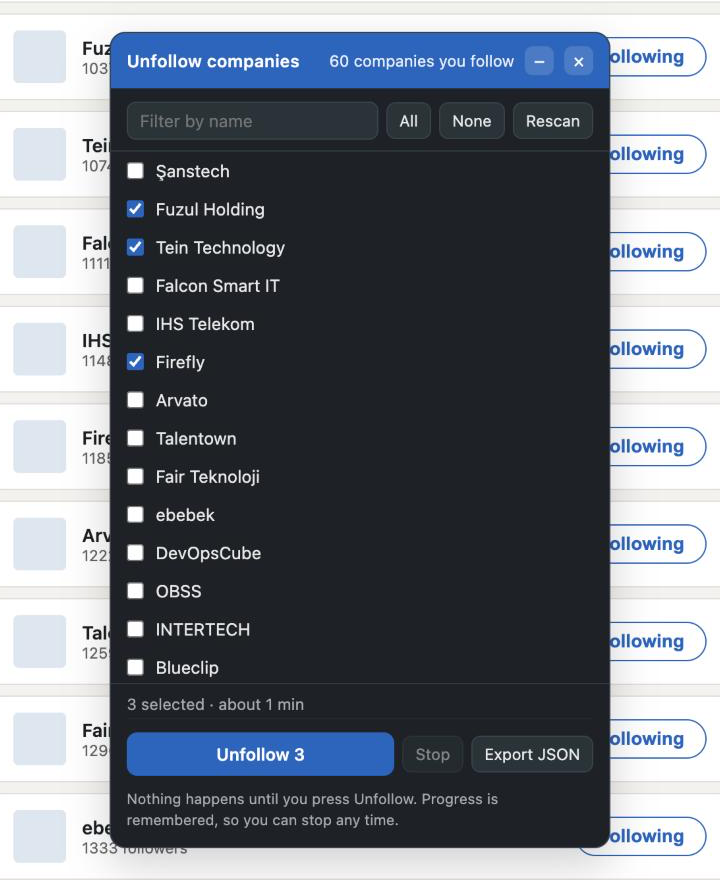

<div align="center">

# linkedin-unfollower

**300 LinkedIn şirketini 300 kez tıklamadan takipten çıkar.**

Tek dosyayı tarayıcı konsoluna yapıştır. Bir panel açılır, takip ettiğin tüm
şirketleri listeler ve işaretlediklerini takipten çıkarır — LinkedIn'in fark
etmeyeceği kadar yavaş, sekmeyi istediğin an kapatabileceğin kadar da
kaldığı yerden devam edebilir.

[](LICENSE)
[](#kurulum)
[](#rust-cli)
[](https://github.com/enesyaks/Linkedin-Unfollower/stargazers)

### [→ Kodu al (tek düğme)](https://enesyaks.github.io/Linkedin-Unfollower/)



</div>

---

## Neden

LinkedIn toplu takipten çıkarma sunmuyor. Şirketler sayfası 20'şer 20'şer
yükleniyor ve her takipten çıkarma ayrı bir tıklama. Birkaç yüz şirket takip
ediyorsan — iş aradıktan sonra ediyorsun — bu bir öğlen sonu demek.

Bu işi çözen araçların çoğu LinkedIn'in dahili API endpoint'lerini kodun içine
gömüyor ve birkaç ay içinde bozuluyor. Bu araç hiçbir şey gömmüyor: butonları
**erişilebilirlik etiketinden** buluyor, ki LinkedIn onu ekran okuyucuları
bozmadan değiştiremez.

## Kurulum

Klonlamak yok, npm yok, derleme yok. Üç yol, en iyisi başta.

### 1. Kopyala düğmesi — hiçbir şey kurmadan

**[enesyaks.github.io/Linkedin-Unfollower](https://enesyaks.github.io/Linkedin-Unfollower/)**
adresine git, **Kodu kopyala**'ya bas, sonra
[şirketler sayfanı](https://www.linkedin.com/mynetwork/network-manager/company/)
aç, `⌘⌥J` / `F12`, yapıştır, Enter. Chrome yapıştırmayı engellerse bir kez
`allow pasting` yaz.

O sayfa kopyalamadan önce dosyanın tamamını da gösteriyor — giriş yapmış bir
hesabın yanında çalıştıracağın her şey için doğru alışkanlık bu.

### 2. Userscript — bir kez kur, hep dursun

[Tampermonkey](https://www.tampermonkey.net/) veya
[Violentmonkey](https://violentmonkey.github.io/) kur, sonra
[`web/unfollow.js`](web/unfollow.js) dosyasını ham (raw) halde aç ve kur'a bas.
Panel, şirketler sayfana her girdiğinde kendiliğinden açılır.

### 3. DevTools Snippet — bir kez yapıştır, hep çalıştır

Chrome'da: DevTools → **Sources** → **Snippets** → yeni snippet →
[`web/unfollow.js`](web/unfollow.js) içeriğini yapıştır → kaydet. Sonra her
seferinde `⌘⏎` / `Ctrl+Enter` ile çalıştır.

> **Neden tek satırlık bir bookmarklet yok.** LinkedIn
> `script-src 'strict-dynamic' 'nonce-…'` gönderiyor; bu dosyayı GitHub'dan
> çeken bir kısayol sayfanın CSP'si tarafından engelleniyor — tahmin değil,
> ölçtük. Dosyanın tamamının konsola gelmesi gerekiyor, ya da sayfa CSP'sini
> aşan bir userscript yöneticisi kullanman. İyi tarafı: çalıştırmadan önce her
> satırını okuyabilirsin.

## Kullanım

Panel açılır açılmaz tüm listeni tarar (135 şirket için yaklaşık 20 saniye).
Sonrası: filtrele, işaretle, **Unfollow**'a bas, onaylamak için tekrar bas.

Sen onaylamadan hiçbir şeye tıklanmaz. İlerleme her şirketten sonra kaydedilir;
istediğin an durup günler sonra kaldığın yerden devam edebilirsin.

<details>
<summary><b>Konsol API'si</b> — panelin yaptığı her şey, script'lenebilir hâlde</summary>

```js
await LIU.scan()                        // tüm listeyi yükle
LIU.list()                              // tablo olarak yazdır
LIU.download()                          // companies.json indir
await LIU.unfollow()                    // PROVA — hiçbir şeye tıklamaz
await LIU.unfollow({ confirm: true })   // gerçek, çalıştırma başına en fazla 50
LIU.open()                              // paneli tekrar aç
LIU.stop()                              // mevcut adımdan sonra durdur
LIU.config({ minDelay: 4000 })          // daha yavaş çalış
LIU.resetState()                        // yapılanları unut
```

| Komut | Ne yapar |
|---|---|
| `LIU.unfollow({ confirm: true, limit: 10 })` | sadece ilk 10'u |
| `LIU.unfollow({ only: /recruit/i, confirm: true })` | isim/slug regex'e uyanlar |
| `LIU.unfollow({ except: ['Acme Corp'], confirm: true })` | bunlar kalsın |

</details>

## Nasıl dikkat çekmiyor

| | |
|---|---|
| Tıklamalar arası | 1.8–4.2 sn, rastgele |
| Uzun mola | her 15 işlemde 20–40 sn |
| Katı sınır | çalıştırma başına 50 |
| Şunlarda durur | HTTP 429 / 999 / 403 veya üst üste 3 hata |
| Hatırladığı | biten her şirket, `localStorage`'da |

5 dakikalık bir çalıştırmada yaklaşık 50 şirket. 400'ünü tek oturumda yapmak
seni doğrudan rate-limit sayfasına götürür; birkaç kez çalıştır.

## Rust CLI

Birkaç yüz şirket için, başında beklemeden, tarayıcın serbestken. LinkedIn
API'si hakkında **hiçbir** bilgi içermez: kendi Network sekmenden gerçek bir
takipten-çıkarma isteği yakalar, şirket kimliğini `{urn}` ile işaretler ve CLI
onu token bucket, exponential backoff ve kaldığı yerden devam eden bir kayıt
dosyasıyla tekrar oynatır.

```bash
cd cli && cargo build --release
```

```bash
liunfollow run --list companies.json --request unfollow.curl --max 25 --yes
```

`--yes` vermediğin her çalıştırma provadır. Adım adım:
[docs/capture.md](docs/capture.md).

<details>
<summary><b>Seçenekler</b></summary>

```
--only <REGEX>        sadece isim/slug/urn eşleşen şirketler
--except <REGEX>      eşleşenleri atla
--max <N>             tek çalıştırmada en fazla N şirket          [50]
--interval <SANIYE>   istekler arası temel aralık                 [4.0]  (en az 0.5)
--jitter <0..1>       her aralığı bu oranda rastgeleleştir        [0.4]
--batch-size <N>      her N istekte uzun mola, 0 = kapalı         [15]
--batch-pause <SN>    bu molanın süresi                           [30]
--retries <N>         rate limit'te şirket başına yeniden deneme  [3]
--abort-after <N>     üst üste N hatadan sonra vazgeç             [3]
--backoff <SANIYE>    ilk geri çekilme, her denemede ikiye katlar [60]   (en az 1)
--backoff-max <SN>    bu katlanmanın tavanı                       [900]
--retry-failed        daha önce başarısız olanları tekrar dene
--state <DOSYA>       kayıt dosyası        [liunfollow-state.json]
--yes                 istekleri gerçekten gönder
```

</details>

## Bilmekte fayda var

- LinkedIn Kullanıcı Sözleşmesi otomatik erişimi kısıtlar. Panel, senin de
  tıklayacağın butonlara, senin dayanabileceğinden daha yavaş tıklıyor; CLI
  ise senin kendi yaptığın isteği tekrarlıyor. Bu yine de otomasyondur ve risk
  sana aittir.
- Yakaladığın cURL dosyası oturum çerezini içerir. `chmod 600` yap. CLI onu
  yazdırdığı her satırda maskeler, `.gitignore` da `*.curl` dosyalarını engeller.
- Bu depo çalışan hiçbir LinkedIn endpoint'i, query id'si veya token'ı içermez.
- LinkedIn'in hem İngilizce hem Türkçe arayüzünde çalışır.

## Geliştirme

```bash
make test
```

61 test, ağ gerekmiyor: Rust tarafında HTTP ve saat trait arkasında; JavaScript
tarafı LinkedIn'in gerçek etiket biçimlerini taşıyan elle yazılmış sahte bir
DOM üzerinde koşuyor. `web/test/fixture.html` şirketler sayfasının yerel
taklidi — hesaba dokunmadan baştan sona bir çalıştırmayı deneyebilirsin,
bkz. [CONTRIBUTING.md](CONTRIBUTING.md).

## Lisans

MIT © Enes — [LICENSE](LICENSE).

English: **[README.md](README.md)**
